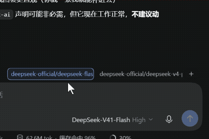

# dsh-model-quickslots

[English](README.md) · [简体中文](README.zh-CN.md) · **日本語**

[](https://www.npmjs.com/package/@moruteaven/dsh-model-quickslots)
[](./LICENSE)
[](https://github.com/deepseek-ai)
[](https://gitee.com/moruteaven/dsh-model-quickslots)

[DeepSeek Harness](https://github.com/deepseek-ai)（DSH）の入力欄の上に、モデルをワンクリックで切り替えるプリセットボタンの列を追加します。各ボタンは 1 つのプリセット（プロバイダー + モデル + 思考強度）に対応します。**左クリック**で現在のセッションのモデルを切り替え、**右クリック**で編集ダイアログを開きます。

## 機能

- **ワンクリック切り替え** — 左クリックで、現在のセッションのモデルと思考強度を切り替えます。
- **カスタム名** — 各プリセットには自由な名前を付けられます。モデル名である必要はありません。「高速」「じっくり思考」など。
- **右クリックで編集** — 任意のプリセットを右クリックすると、プロバイダー・モデル・思考強度・名前を変更できます。
- **モデルカタログ連動** — 編集ダイアログのドロップダウンは、現在のセッションで実際に利用可能なモデルから生成されます。モデル一覧のハードコードはありません。
- **現在のプリセットを強調** — 現在のセッションのモデルと一致するプリセットは枠線で示されます。
- **失敗の通知** — 切り替えに失敗したプリセットは赤くなり、無言で失敗しません。
- **ローカル保存** — プリセットはブラウザーの `localStorage` に保存されます。アカウントも同期サービスも不要です。
- **テーマ対応** — DSH のテーマ変数を使用しているため、ライト／ダークテーマに追従します。

## デモ

プリセットを左クリックすると、現在のセッションのモデルが切り替わります：



## スクリーンショット

プリセットボタンは入力欄のすぐ上に、入力カードと揃うように並びます：


プリセットを右クリックすると編集できます。ドロップダウンは実際のモデルカタログから生成されます：


## インストール

### npm から（推奨）

```bash
pnpm add @moruteaven/dsh-model-quickslots
```

その後、このパッケージをプロファイルの `dsh.profile.bundles` に追加し、DSH を再起動してください。

### DSH プラグインマネージャーから

**設定 → プラグイン** を開き、`@moruteaven/dsh-model-quickslots` を検索してインストールします。

### ソースからビルド

2 つの公開リポジトリは同期しています。アクセスの速い方を選んでください：

```bash
# GitHub
git clone https://github.com/MoruTeaven/dsh-model-quickslots.git

# Gitee（中国本土向けミラー、アクセスが高速）
git clone https://gitee.com/moruteaven/dsh-model-quickslots.git

cd dsh-model-quickslots
pnpm install
pnpm build
```

## 使い方

| 操作 | 結果 |
| --- | --- |
| プリセットを**左クリック** | 現在のセッションをそのプリセットのモデル構成に切り替え |
| プリセットを**右クリック** | そのプリセットの編集ダイアログを開く |
| **+** をクリック | 新しいプリセットを作成 |
| **Esc** を押す | 編集ダイアログを閉じる |
| **Ctrl/Cmd + Enter** を押す | プリセットを保存 |

プリセットがまだ 1 つもない場合、ボタン列には「モデルプリセット」の入口だけが表示されます。それをクリックして最初のプリセットを作成してください。

ボタン列は入力欄のすぐ上にあり、入力カードの右端に揃います。

## 開発

```bash
pnpm build   # lib/client.js（ブラウザー側）と lib/index.js（ホスト側）をビルド
pnpm dev     # 変更を監視して自動再ビルド
pnpm test    # セルフテストを実行
```

本プラグインは純粋なクライアント側 Web プラグインで、`conversation.input.dock` スロットに登録されます。モデルの切り替えは DSH 標準のモデルディレクトリサービスを経由するため、可用性の判定や競合処理を含め、標準のモデル選択 UI とまったく同じ挙動になります。

## ライセンス

[MIT](./LICENSE)

## 作者

抹露茶柒 (MoruTeaven) — me@MoruTeaven.com — www.MoruTeaven.com
