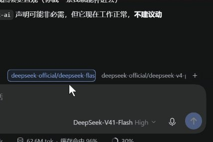
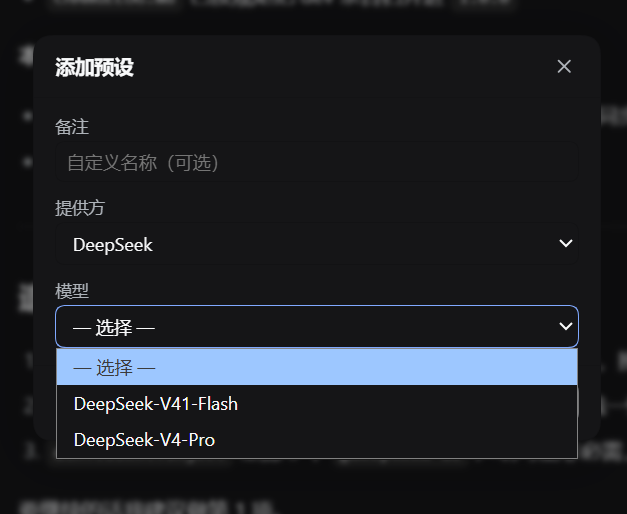

# dsh-model-quickslots

**English** · [简体中文](README.zh-CN.md) · [日本語](README.ja.md)

[](https://www.npmjs.com/package/@moruteaven/dsh-model-quickslots)
[](./LICENSE)
[](https://github.com/deepseek-ai)

A row of one-click model preset buttons for the [DeepSeek Harness](https://github.com/deepseek-ai) (DSH) composer. Each button is a saved preset — provider + model + reasoning effort. **Left-click** switches the current session's model; **right-click** opens the editor.

## Features

- **One-click switching** — left-click a preset to switch the current session's model and reasoning effort.
- **Custom labels** — every preset can carry its own name, so it does not have to read like a model id. Name one "Fast" and another "Deep thinking".
- **Right-click to edit** — right-click any preset to change its provider, model, effort, or label.
- **Live model catalog** — the editor's dropdowns are populated from the models actually available to the current session. No hardcoded model list.
- **Active preset highlight** — the preset matching the session's current model is outlined.
- **Failure feedback** — a preset whose switch fails turns red instead of failing silently.
- **Local persistence** — presets are stored in the browser's `localStorage`; no account or sync service involved.
- **Theme aware** — styled with DSH theme variables, so it follows light and dark themes.

## Screenshots

Preset buttons sit right above the composer, aligned with the input card:



Right-click a preset to edit it — the dropdowns come from your live model catalog:



## Installation

### From npm (recommended)

```bash
pnpm add @moruteaven/dsh-model-quickslots
```

Then add the package to your profile's `dsh.profile.bundles` list and restart DSH.

### Via the DSH plugin manager

Open **Settings → Plugins**, search for `@moruteaven/dsh-model-quickslots`, and install it.

### From source

```bash
git clone https://github.com/MoruTeaven/dsh-model-quickslots.git
cd dsh-model-quickslots
pnpm install
pnpm build
```

## Usage

| Action | Result |
| --- | --- |
| **Left-click** a preset | Switch the session to that preset's model configuration |
| **Right-click** a preset | Open the editor for that preset |
| Click **+** | Create a new preset |
| Press **Esc** | Close the editor |
| Press **Ctrl/Cmd + Enter** | Save the preset |

When you have no presets yet, the row shows a single **Model presets** entry — click it to create your first one.

The button row sits directly above the composer and lines up with the input card's right edge.

## Development

```bash
pnpm build   # bundle lib/client.js (browser half) and lib/index.js (host half)
pnpm dev     # rebuild on change
pnpm test    # run the self-test suite
```

The plugin is a pure client-side Web plugin registered into the `conversation.input.dock` slot. Model switching goes through DSH's own model-directory service, so it behaves exactly like the built-in model picker — including its availability rules and race handling.

## License

[MIT](./LICENSE)

## Author

抹露茶柒 (MoruTeaven) — me@MoruTeaven.com — www.MoruTeaven.com
